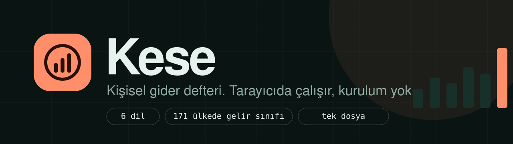

<div align="center">



<br>


**Harcamalarını kategorilere ayır, bütçeni izle, ayları karşılaştır.**<br>
Tarayıcıda çalışır, sunucu ve derleme gerekmez.

[Özellikler](#özellikler) · [Hızlı başlangıç](#hızlı-başlangıç) · [Gelir sınıfı](#gelir-sınıfı-nasıl-hesaplanır) · [Gizlilik](#veriler-ve-gizlilik) · [Yol haritası](#yol-haritası)

</div>

---

## Özellikler

<table>
<tr>
<td width="50%" valign="top">

### Gider takibi
Tarih, tutar, açıklama, kategori, ödeme yöntemi ve not. Düzenle, sil, ara, kategoriye göre süz.

### Kategoriler ve bütçe
Kendi kategorilerini renkle ekle, aylık bütçe koy. Bütçe aşılınca kırmızı uyarı.

### Aylık özet
Toplam, gider sayısı, günlük ortalama, en büyük kategori. Halka grafikle kategori dağılımı.

</td>
<td width="50%" valign="top">

### Gün gün takvim
Ayın her günü harcamaya göre renklenir. Bir güne basınca o günün giderleri açılır.

### Ayları karşılaştır
Son 6 ayın harcamaları yan yana.

### Dışa aktarma
Seçili ayı tek tıkla CSV olarak indir. Excel'de Türkçe karakterlerle açılır.

</td>
</tr>
<tr>
<td valign="top">

### Ülkeye göre gelir sınıfı
Gelirini girince, ülkenin Dünya Bankası istatistiklerine göre nerede durduğunu dayanak rakamlarıyla birlikte görürsün. 171 ülke için veri var.

</td>
<td valign="top">

### 6 dil, tüm para birimleri
Türkçe, English, Deutsch, Français, Español, Русский. Ülke seçince dil önerilir. Dünyadaki para birimlerinden birini seçersin.

</td>
</tr>
</table>

Ayrıca hareketli bir açılış sayfası ve ülkeni seçip günlük gelirini kaydırarak sınıfını anında gördüğün **"Kendin dene"** aracı var.

## Hızlı başlangıç

```bash
git clone https://github.com/fahriefe/kese.git
cd kese
```

Sonra `index.html` dosyasına çift tıkla. Hepsi bu.

İstersen yerel sunucuyla da açabilirsin:

```bash
npx serve .
```

İlk açılışta **Hesap oluştur** ile kayıt ol (ülke, şehir, para birimi seç), sonra gider eklemeye başla.

## Gelir sınıfı nasıl hesaplanır

<details>
<summary>Yöntemi göster</summary>

<br>

Dünya Bankası'nın günlük gelire göre üç yoksulluk sınırı vardır (2021 satın alma gücü paritesiyle, kişi başı):

| Sınır | Anlamı |
| --- | --- |
| günde 3,00 $ altı | Aşırı yoksul |
| 3,00 – 4,20 $ | Yoksul |
| 4,20 – 8,30 $ | Alt-orta gelir |
| 8,30 $ üstü | Orta ve üzeri |

Girdiğin aylık hane gelirini hane kişi sayısına bölüp, ülkenin satın alma gücü katsayısıyla günlük dolara çeviriyoruz. 8,30 $ üstündeki kısım Dünya Bankası'nda tek grup olduğu için Orta, Üst-orta ve Varlıklı ayrımını ülkenin **Gini katsayısı** ve 8,30 $ altındaki nüfus payına uydurduğumuz bir **log-normal model** ile tahmin ediyoruz (ilk %75 orta, %75–90 üst-orta, ilk %10 varlıklı).

> [!WARNING]
> Bu kaba bir tahmindir, kesin değildir. Üst sınıflar modelden gelir; yüksek enflasyonlu ülkelerde sapma olabilir. Kart her zaman dayanak istatistikleri ve bir uyarı notu gösterir.

</details>

## Veriler ve gizlilik

| Konu | Durum |
| --- | --- |
| **Hesaplar ve giderler** | Yalnızca kendi tarayıcının `localStorage` alanında. Sunucuya gönderilmez. |
| **Parolalar** | Düz yazı olarak değil, PBKDF2 (SHA-256, 150.000 tur) ile özetlenerek saklanır. |
| **Cihazlar arası** | Hesap başka cihazda veya tarayıcıda görünmez. Tarayıcı verisini silersen kayıtlar da silinir. |
| **Dış kaynaklar** | Google Fonts (yazı tipleri) ve `countriesnow.space` (Türkiye dışı şehir listesi; yalnızca ülke bilgisi çekilir). |
| **İstatistikler** | [World Bank Open Data](https://data.worldbank.org/), CC BY 4.0. Özet tablo: [`veri/ulke_verileri.csv`](veri/ulke_verileri.csv) |

> [!NOTE]
> Bu, gerçek bir sunucu tabanlı kimlik doğrulamanın yerini tutmaz. Aynı bilgisayarı kullanan biri tarayıcı verilerine erişebilir.

## Proje yapısı

```text
kese/
├── index.html            uygulamanın tamamı (HTML + CSS + JS)
├── assets/               logo ve banner (SVG)
├── veri/
│   └── ulke_verileri.csv ülke bazlı Dünya Bankası veri özeti
├── PRODUCT.md            ürün bağlamı: kullanıcılar, amaç, ilkeler
├── DESIGN.md             tasarım sistemi notları
└── LICENSE
```

## Yol haritası

- [x] Hesap sistemi, kategoriler, bütçe, aylık özet
- [x] Ülkeye göre gelir sınıfı, 6 dil, para birimi seçimi
- [x] Halka grafik ve gün gün takvim
- [ ] Sunucu tabanlı hesaplar (ör. Supabase), cihazlar arası senkron
- [ ] Parola sıfırlama, profil düzenleme (ülke / şehir / para birimi)
- [ ] Tekrarlayan giderler ve hatırlatmalar
- [ ] CSV içe aktarma
- [ ] Çevirilerin ana dili olanlarca gözden geçirilmesi

## Lisans

[MIT](LICENSE) © 2026 fahriefe
